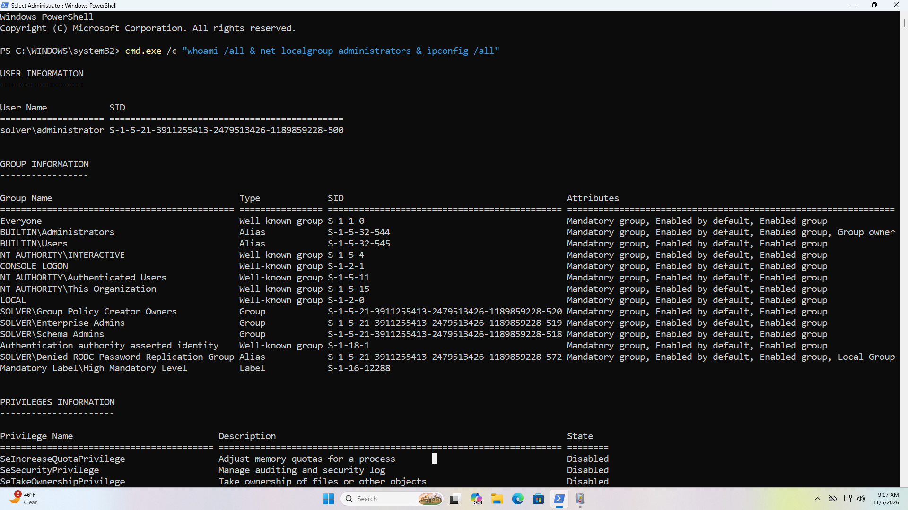
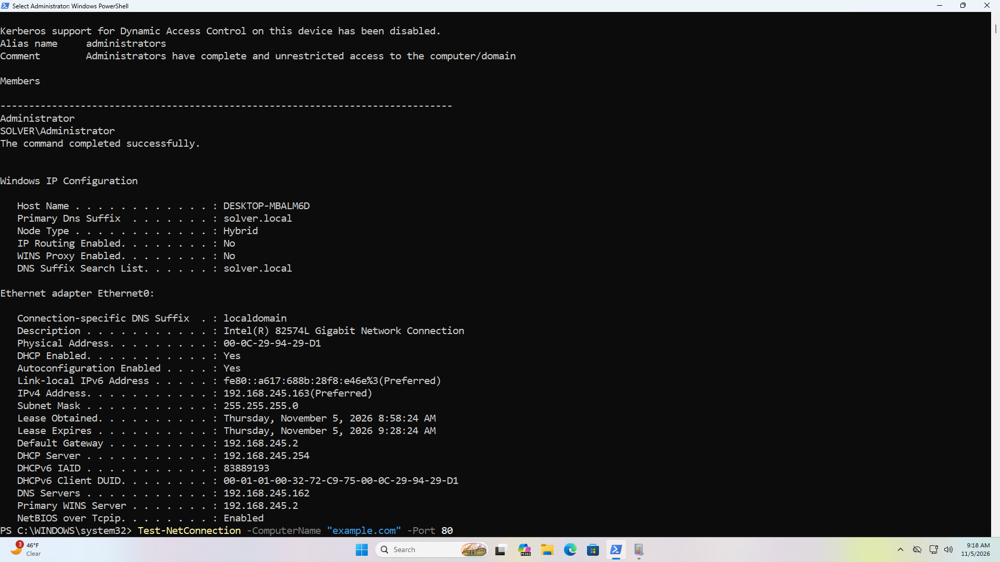
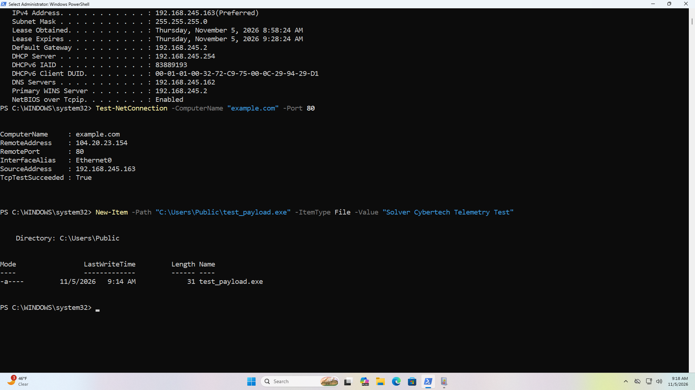
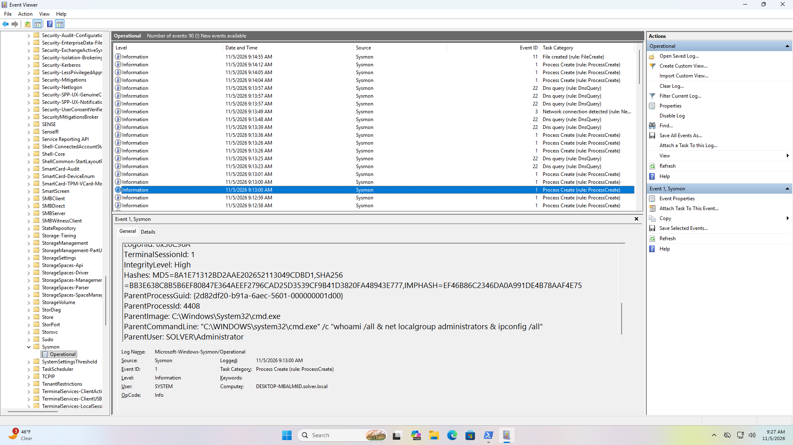
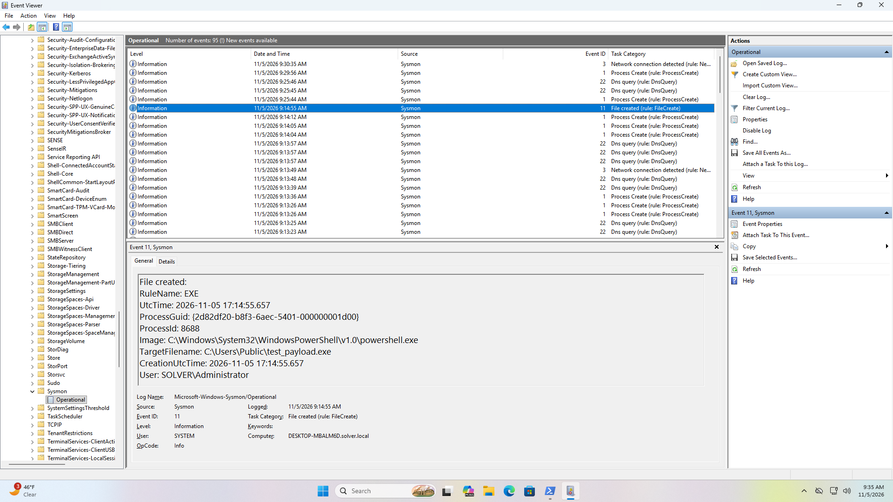
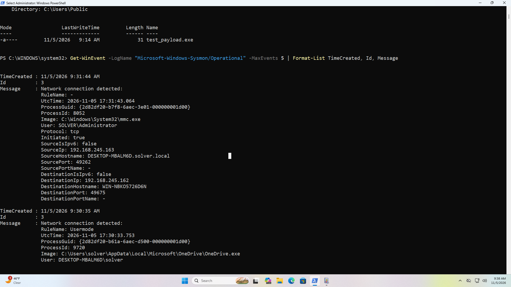

# 🛡️ Enterprise Endpoint Telemetry & Adversary Emulation Lab

## Executive Summary
Engineered under the **Solver Cybertech** brand, this repository demonstrates production-grade endpoint detection engineering, forensic telemetry collection, and adversarial behavior simulation. Built inside an enterprise Active Directory domain (`solver.local`), this lab bridges the gap between raw Windows operating system telemetry and actionable Security Operations Center (SOC) threat hunting. 

By deploying **Microsoft Sysinternals Sysmon v15** hardened with the industry-standard **SwiftOnSecurity baseline**, this project provides concrete architectural proof of how organizations capture high-fidelity adversary indicators, bypass default OS visibility limitations, and programmatically query event streams for rapid incident triage.

---

## Technical Architecture & Infrastructure Scope
* **Domain Controller:** Windows Server 2025 Standard (`solver.local` | `192.168.245.162`)
* **Target Endpoint:** Windows Workstation (`DESKTOP-MBALM6D.solver.local`)
* **Telemetry Engine:** Microsoft Sysinternals Sysmon v15.x (64-bit)
* **Configuration Schema:** SwiftOnSecurity Hardened XML Baseline (`sysmonconfig-export.xml`)
* **Telemetry Ingestion Channel:** `Applications and Services Logs/Microsoft/Windows/Sysmon/Operational`

---

## Architectural Implementation & Engineering Phases

### Phase 1: Core Sysmon Deployment & Baseline Hardening
Default Windows Security logging lacks the granular process-argument tracking and image-hash generation required for modern threat analysis. This phase established hardened endpoint telemetry collection.

1. Provisioned a dedicated administrative working directory (`C:\Sysmon`) to host binaries and local schema files.
2. Deployed Sysmon64 enforcing the SwiftOnSecurity XML baseline to filter out benign OS noise while aggressively capturing anomalous process injection, network, and file system telemetry.
3. Verified active service state (`Running`) and operational event log registration.

```powershell
New-Item -Path "C:\Sysmon" -ItemType Directory -Force
Set-Location -Path "C:\Sysmon"
Invoke-WebRequest -Uri "[https://live.sysinternals.com/Sysmon64.exe](https://live.sysinternals.com/Sysmon64.exe)" -OutFile "C:\Sysmon\Sysmon64.exe"
Invoke-WebRequest -Uri "[https://raw.githubusercontent.com/SwiftOnSecurity/sysmon-config/master/sysmonconfig-export.xml](https://raw.githubusercontent.com/SwiftOnSecurity/sysmon-config/master/sysmonconfig-export.xml)" -OutFile "C:\Sysmon\sysmonconfig.xml"
.\Sysmon64.exe -i sysmonconfig.xml -accepteula
Get-Service sysmon64

```

---

### Phase 2: Controlled Attack Simulation & MITRE ATT&CK Mapping
To validate telemetry pipeline integrity, multi-stage post-exploitation tactics mapped directly to the **MITRE ATT&CK Framework** were executed on the endpoint.

1. **Discovery & Enumeration (T1033 / T1069.001):** Executed native command chains to simulate internal reconnaissance and privilege checks (`whoami /all`, `net localgroup administrators`, `ipconfig /all`).
2. **Network Service Discovery (T1046):** Emulated active probing against external infrastructure to test network connection logging.
3. **Ingress Tool Transfer / File Staging (T1105):** Staged a mock binary payload (`test_payload.exe`) within a sensitive user-accessible directory (`C:\Users\Public`).





---

### Phase 3: Telemetry Deep-Dive & Forensic Analysis
Analyzed raw telemetry captured inside the Windows Event Log pipeline to evaluate detection fidelity.

1. **Process Creation Tracking (Event ID 1):** Unpacked full parent-child process lineage (`explorer.exe` -> `powershell.exe` -> `cmd.exe` -> `whoami.exe`), extracting explicit command-line arguments, process GUIDs, cryptographic SHA256 hashes, and execution context (`SOLVER\Administrator`).
2. **File Creation Monitoring (Event ID 11):** Confirmed real-time interception and logging of unverified file drops targeting `C:\Users\Public\test_payload.exe`, proving visibility over potential staging directories.




---

### Phase 4: Programmatic Log Parsing & Automated Triage (PowerShell)
Equipped for high-speed incident response by bypassing GUI dependencies and parsing telemetry programmatically.

1. **Automated Event Extraction:** Leveraged PowerShell `Get-WinEvent` to pull, filter, and structure operational event streams for rapid triage during simulated threat hunting operations.

```powershell
Get-WinEvent -LogName "Microsoft-Windows-Sysmon/Operational" -MaxEvents 5 | Format-List TimeCreated, Id, Message

```



---

## Core Technical Competencies Demonstrated
- **Advanced Endpoint Telemetry:** Microsoft Sysinternals Sysmon v15 deployment, SwiftOnSecurity configuration hardening, and custom XML tuning.
- **Threat Detection & Adversary Emulation:** Practical mapping to MITRE ATT&CK (Discovery, Reconnaissance, Ingress Staging), Event ID 1 (Process Creation), and Event ID 11 (File Creation).
- **Digital Forensics & Incident Response (DFIR):** Parent-child process hierarchy tracking, SHA256 hash analysis, and programmatic log parsing via PowerShell (`Get-WinEvent`).
- **Enterprise Security Operations:** Active Directory domain workstation integration, audit trail verification, and SIEM-ready log pipeline architecture.


## Author & Engineering Portfolio
**Peter Okonkwo**  
Lead Engineer @ Solver Cybertech  
- **GitHub:** [github.com/solver113](https://github.com/solver113)  
- **LinkedIn:** [linkedin.com/in/peter-okonkwo-3b6610230](https://www.linkedin.com/in/peter-okonkwo-3b6610230)
